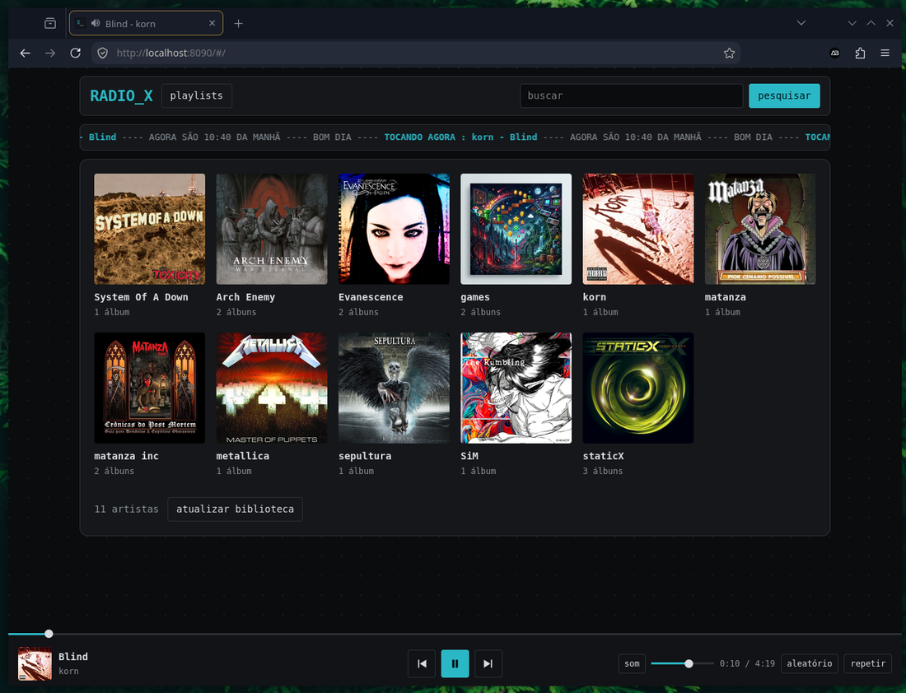
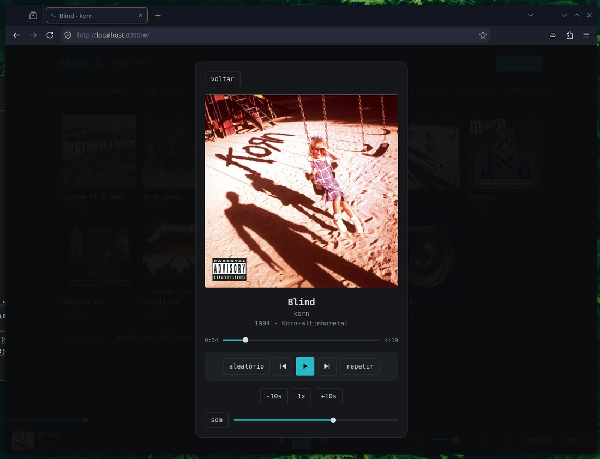

# Radio X

**English** · [Português](README.pt-BR.md)

A small, self-hosted music library for your own files. Point it at a folder, open it on your phone or PC, and listen. No accounts, no database to set up, no tag editing: **folders are artists, subfolders are albums**.

<p align="center">
  
  
</p>

## Features

- Library built from your folder structure (artist / album), with covers from `cover.jpg`, `folder.jpg` and similar files (or the cover embedded in the audio file)
- Search, playlists, shuffle, repeat, ±10 s skip and playback speed
- Phone-friendly: lock screen and headset controls (cover, title, play/pause, next/previous, progress)
- Automatically notices new, removed or renamed folders (checks every 60 s)
- Install as an app on your phone's home screen
- One command to configure, start and show a **QR code** for your phone
- Optional "private folders" hidden behind a PIN (see the [security notice](#security-notice))
- Runs in a container (Podman or Docker) and mounts your music **read-only**

## Quick start

Requires [Podman](https://podman.io/) (`sudo apt install podman` on Debian/Ubuntu/Mint).

```bash
git clone https://github.com/antonio-ebarros/radiox.git
cd radiox
./radiox.sh
```

The first run asks for your music folder and a port, opens the firewall port if you want, builds and starts the container and prints a **QR code**. Scan it with your phone camera (same Wi-Fi) and you are listening. Next runs just start it and show the QR again.

| Command | What it does |
|---|---|
| `./radiox.sh` | Set up on first use, otherwise start and show the QR |
| `setup` / `start` / `stop` / `restart` | Configure, start, stop, restart |
| `qr` | Show the QR code and address again |
| `pin` | Set the PIN for private folders |
| `rescan` | Rescan the library now |
| `update` | Rebuild the image after changing the code, then restart |
| `status` / `logs` | Check if it is running / follow the logs |
| `autostart` | Start Radio X when the computer boots |

### Docker / Podman Compose (any OS)

```bash
cp .env.example .env     # edit MUSIC_PATH and PORT
docker compose up -d --build        # or: podman compose up -d --build
```

Open `http://localhost:8090` (or `http://<your-pc-ip>:8090` from your phone). On Windows use a path like `MUSIC_PATH="C:/Users/you/Music"`. On SELinux systems (Fedora) add `:z` to the music volume in `compose.yaml`.

Set a PIN with compose:

```bash
docker exec -it radiox sh -c 'printf "PIN: "; stty -echo; read p; stty echo; echo; echo "$p" > /data/pin.txt'
```

> The `radiox.sh` script is written for Linux (bash). I have only tested Radio X on Linux Mint with Podman; Docker, Windows and macOS through Compose should work but are untested.

## Library layout

```
/music/metallica/Black Album/01 - Enter Sandman.flac
/music/metallica/Black Album/cover.jpg       (cover / folder / front / capa / album, .jpg .png .webp)
/music/metallica/artist.jpg                  (optional artist picture)
/music/metallica/loose-song.mp3              (becomes the "singles" album)
```

Supported audio: mp3, flac, ogg/oga, opus, m4a, aac, wav. Track titles come from file names (leading numbers are stripped).

## On your phone

- **QR code:** `./radiox.sh qr` prints it again at any time.
- **Lock screen:** cover, title and controls appear in the system player and on headsets. Tracks from private folders show only "Radio X".
- **Home screen:** on iPhone use Share → *Add to Home Screen*; on Android use the Chrome menu → *Add to Home screen*. A full install without the browser bar on Android requires HTTPS (for example through [Tailscale](https://tailscale.com/)); over plain `http://` it creates a shortcut.

## Private folders

Put an empty file named `.privado` inside an artist folder (hides the artist) or an album folder (hides that album), set a PIN with `./radiox.sh pin`, then tap the `_` in the logo (`RADIO_X`) to unlock; tap again to lock. While unlocked the `_` blinks and private items are marked with `*`. Restarting the container locks everything.

## Configuration

| Variable | Default | Meaning |
|---|---|---|
| `MUSIC_PATH` | – | Your music folder on the host (mounted read-only) |
| `PORT` | `8090` | Port on the host |
| `AUTO_SCAN_SECONDS` | `60` | Interval of the automatic folder check; `0` disables it |

`radiox.sh setup` writes these to `.env`. Playlists and the PIN live in the `radiox-data` volume, so they survive updates.

## Security notice

Radio X is built for a **trusted home network**. Please read this before exposing it:

- **No user accounts and no HTTPS.** Anyone who can reach the port can browse, play and edit playlists of the non-private library. Do not forward the port on your router or publish it on the internet.
- **The PIN is a "nosy person" filter, not strong security.** It keeps private folders out of sight for someone borrowing your phone or sharing your Wi-Fi, and the server does refuse private files while locked. But the PIN travels unencrypted over plain HTTP, and there is no per-user login.
- **Need access away from home?** Use a VPN or a private network such as Tailscale or WireGuard instead of opening the port.
- Your music folder is mounted **read-only**; Radio X never changes your files.

To report a vulnerability, see [SECURITY.md](SECURITY.md).

## License

[MIT](LICENSE) © 2026 Antonio Eduardo
