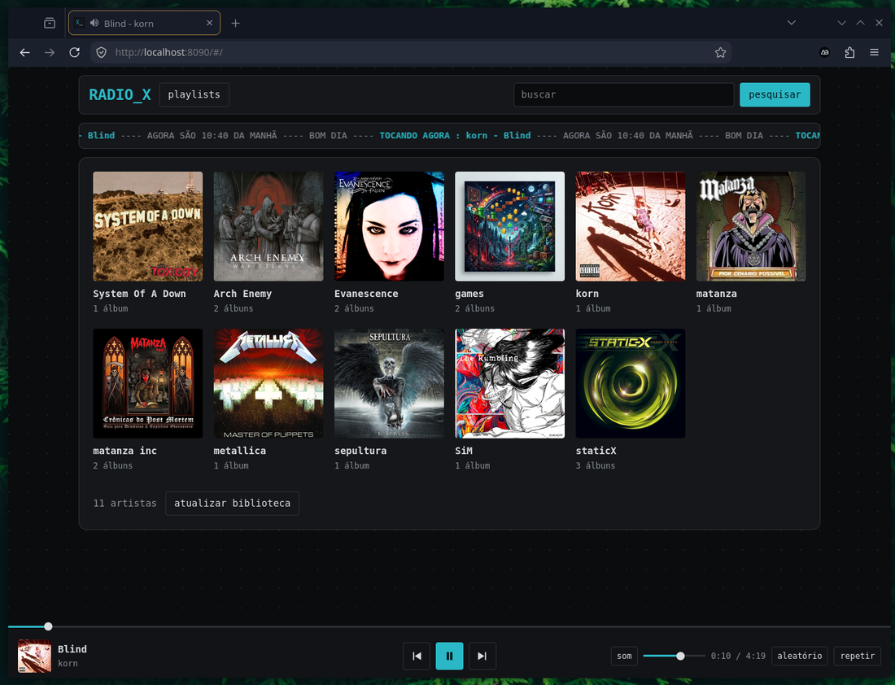
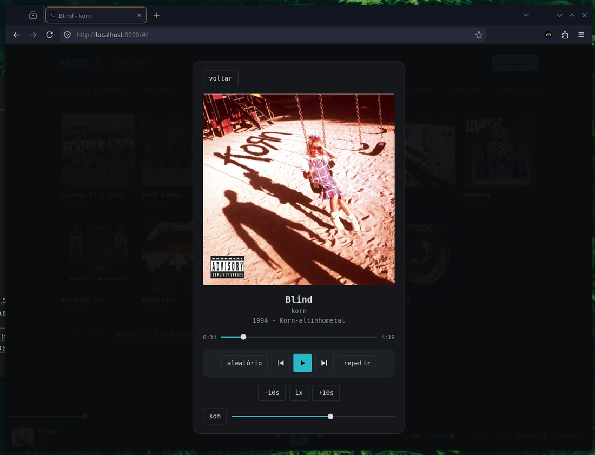

# Radio X

[English](README.md) · **Português**

Uma biblioteca de música pessoal e auto-hospedada para os seus próprios arquivos. Aponte para uma pasta, abra no celular ou no PC e ouça. Sem contas, sem banco para configurar, sem editar tags: **pasta é artista, subpasta é álbum**.

<p align="center">
  
  
</p>

## Recursos

- Biblioteca montada pela estrutura de pastas (artista / álbum), com capas de `cover.jpg`, `folder.jpg` e similares (ou a capa embutida no arquivo de áudio)
- Busca, playlists, aleatório, repetir, pulo de ±10 s e velocidade de reprodução
- Feito para o celular: controles na tela de bloqueio e nos fones (capa, título, play/pausa, próxima/anterior, progresso)
- Percebe sozinho pastas novas, removidas ou renomeadas (confere a cada 60 s)
- Pode ser instalado na tela inicial do celular
- Um comando para configurar, iniciar e mostrar um **QR code** para o celular
- "Pastas privadas" opcionais atrás de um PIN (veja o [aviso de segurança](#aviso-de-segurança))
- Roda em container (Podman ou Docker) e monta suas músicas **somente leitura**

## Começando

Precisa do [Podman](https://podman.io/) (`sudo apt install podman` no Debian/Ubuntu/Mint).

```bash
git clone https://github.com/antonio-ebarros/radiox.git
cd radiox
./radiox.sh
```

Na primeira vez ele pergunta a pasta de músicas e a porta, libera a porta no firewall se você quiser, constrói e inicia o container e mostra um **QR code**. Aponte a câmera do celular (mesmo Wi-Fi) e pronto. Nas próximas vezes ele só inicia e mostra o QR de novo.

| Comando | O que faz |
|---|---|
| `./radiox.sh` | Configura no primeiro uso; depois inicia e mostra o QR |
| `setup` / `start` / `stop` / `restart` | Configurar, iniciar, parar, reiniciar |
| `qr` | Mostra o QR code e o endereço de novo |
| `pin` | Define o PIN das pastas privadas |
| `rescan` | Atualiza a biblioteca agora |
| `update` | Reconstrói a imagem depois de mudar o código e reinicia |
| `status` / `logs` | Mostra se está rodando / acompanha os logs |
| `autostart` | Inicia o Radio X junto com o computador |

### Docker / Podman Compose (qualquer sistema)

```bash
cp .env.example .env     # edite MUSIC_PATH e PORT
docker compose up -d --build        # ou: podman compose up -d --build
```

Abra `http://localhost:8090` (ou `http://<ip-do-pc>:8090` no celular). No Windows use um caminho como `MUSIC_PATH="C:/Users/voce/Music"`. Em sistemas com SELinux (Fedora) adicione `:z` ao volume de músicas no `compose.yaml`.

Para definir o PIN com compose:

```bash
docker exec -it radiox sh -c 'printf "PIN: "; stty -echo; read p; stty echo; echo; echo "$p" > /data/pin.txt'
```

> O script `radiox.sh` é feito para Linux (bash). Só testei o Radio X no Linux Mint com Podman; Docker, Windows e macOS via Compose devem funcionar, mas não foram testados.

## Estrutura da biblioteca

```
/musica/metallica/Black Album/01 - Enter Sandman.flac
/musica/metallica/Black Album/cover.jpg      (cover / folder / front / capa / album, .jpg .png .webp)
/musica/metallica/artist.jpg                 (foto do artista, opcional)
/musica/metallica/solta.mp3                  (vira o álbum "singles")
```

Áudio suportado: mp3, flac, ogg/oga, opus, m4a, aac, wav. Os títulos vêm dos nomes dos arquivos (números no início são removidos).

## No celular

- **QR code:** `./radiox.sh qr` mostra de novo quando quiser.
- **Tela de bloqueio:** capa, título e controles aparecem no player do sistema e nos fones. Faixas de pastas privadas aparecem só como "Radio X".
- **Tela inicial:** no iPhone use Compartilhar → *Adicionar à Tela de Início*; no Android use o menu do Chrome → *Adicionar à tela inicial*. A instalação completa, sem barra do navegador, no Android exige HTTPS (por exemplo com [Tailscale](https://tailscale.com/)); com `http://` simples ele cria um atalho.

## Pastas privadas

Coloque um arquivo vazio chamado `.privado` dentro da pasta de um artista (esconde o artista) ou de um álbum (esconde só o álbum), defina o PIN com `./radiox.sh pin` e toque no `_` do logo (`RADIO_X`) para destrancar; toque de novo para trancar. Enquanto destrancado o `_` pisca e os itens privados aparecem com `*`. Reiniciar o container tranca tudo.

## Configuração

| Variável | Padrão | Significado |
|---|---|---|
| `MUSIC_PATH` | – | Sua pasta de músicas no computador (montada somente leitura) |
| `PORT` | `8090` | Porta no computador |
| `AUTO_SCAN_SECONDS` | `60` | Intervalo da checagem automática de pastas; `0` desliga |

`radiox.sh setup` grava isso no `.env`. Playlists e o PIN ficam no volume `radiox-data`, então sobrevivem às atualizações.

## Aviso de segurança

O Radio X foi feito para uma **rede doméstica confiável**. Leia antes de expor:

- **Sem contas de usuário e sem HTTPS.** Quem alcançar a porta pode navegar, tocar e editar playlists da biblioteca não privada. Não redirecione a porta no roteador nem publique na internet.
- **O PIN é um filtro "anti curioso", não segurança forte.** Ele esconde as pastas privadas de quem pega seu celular emprestado ou divide seu Wi-Fi, e o servidor recusa arquivos privados enquanto está trancado. Mas o PIN viaja sem criptografia em HTTP simples e não existe login por usuário.
- **Precisa acessar fora de casa?** Use uma VPN ou rede privada como Tailscale ou WireGuard, em vez de abrir a porta.
- Sua pasta de músicas é montada **somente leitura**; o Radio X nunca altera seus arquivos.

Para relatar uma vulnerabilidade, veja o [SECURITY.md](SECURITY.md).

## Licença

[MIT](LICENSE) © 2026 Antonio Eduardo
